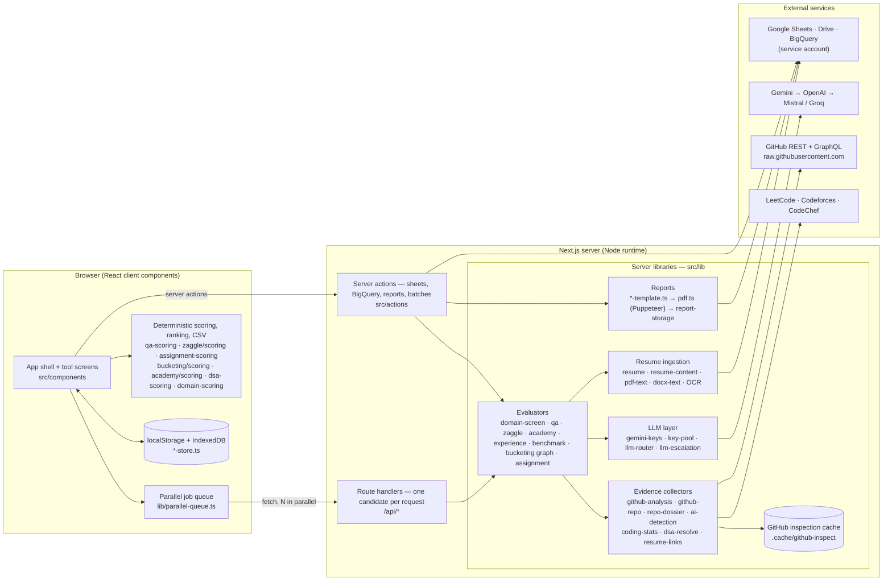

# NxtWave Placements (PSM_CONSOLIDATION)

An internal web app used by the NxtWave placements team to screen, evaluate and shortlist candidates for
hiring partners, and to build the candidate sheets sent to companies.

It is a single Next.js 14 (App Router) application. The browser drives every run; the server reads
resumes, sheets, GitHub and coding profiles and calls the AI models. Results are saved in the browser,
so it is built to run locally for one team rather than as a shared multi-user service.

---

## What it does

Each tool sits in the sidebar, grouped by the job it does in a placement drive.

| Group | Tool | Input | What it produces | Saved runs |
|---|---|---|---|---|
| — | **Dashboard** | — | Companies, saved runs of every tool, source analytics; the eligible pool's numbers and a "Refetch eligible pool" button | — |
| — | **Eligible pool** | The Edge 2.0, Edge 1.0 and Academy pool sheets (or CSV exports) | Who is internally assessed and eligible at each stage, per product, and how that ranks them in Domain shortlisting; refetch and CSV upload | Postgres |
| — | **Standing lookup** | Pasted UUIDs / phone numbers | Internal Standing, Stage and Product per candidate from the internal assessments (no resume), plus one Requirements column with the assessment results you pick; copy for Sheets in the pasted order, or CSV | — |
| Company sheets | **Build company sheet** | Internal Google Sheet (+ optional BigQuery columns) | `<Company> \|\| Nxtwave` CSV with AI screening-report PDF links, skill set and remarks | localStorage |
| | **Analyze company sheet** | A company's Google Sheet | Source split (Edge / Academy / External) and interview-round funnels | localStorage |
| | **Sample profiles** | One Google Sheet of resumes (thousands of rows), and optionally job descriptions | The strongest candidates per tech role — or, with "from job descriptions" on, per JD (the model drafts each profile's definition, mandatory items and every input from the JD) — from the resume, the candidate's own GitHub code and DSA profiles only, to show a company's hiring manager; a company workbook (Candidate IDs, no contact details) and an internal workbook | IndexedDB |
| Screening | **Domain shortlisting** | Google Sheet of candidates + a domain brief | Ranked shortlist: internally assessed candidates first (eligible pool), then resume evidence from projects, experience, certifications and achievements only, GitHub code (with a file-level review of the top projects) and DSA profiles; PDF report + CSVs | — (report on Drive) |
| | **QA screening** | Pasted rows (mobile + resume) | Ranked QA shortlist with per-section skill evidence; CSVs | IndexedDB |
| | **Zaggle SDE 1** | Pasted rows | JD-based screening for one client role (Zaggle SDE 1 Backend); CSVs | IndexedDB |
| | **Candidate bucketing** | Pasted rows / sheet CSV with stage | Candidates sorted into 5 buckets with tags and a trust score; CSVs | IndexedDB |
| | **Academy bucketing** | Three Google Sheets (assessed pool, competency interviews, old process) | Eligible Active Pool candidates bucketed into Frontend / Backend / AI-ML / Full Stack / Mixed for mentor assignment, with a trust agent and a temporary Full Stack → Backend rebalance; Excel workbook + CSVs | IndexedDB |
| Evaluation | **Assignment evaluation** | Assignment document + candidates' repo links | Rubric built from the assignment, every repo reviewed, ranked; CSV | localStorage |
| | **Experience analysis** | Google Sheet | Internships / jobs per candidate: company, role, months, stack; CSV | localStorage |
| | **DSA consolidation** | Google Sheet | LeetCode / Codeforces / CodeChef solved, contests, rating; CSV | localStorage |
| | **Projects consolidation** | Google Sheet | The strongest real-world projects across all resumes; PDF report | — (report on Drive) |
| Reference | **Benchmark projects** | Pasted resumes + one domain | 15+ LPA-grade projects in that domain, exported as Markdown for Notion | IndexedDB |

Feature deep-dives live in [`docs/`](./docs):
- [`architecture.md`](./docs/architecture.md) — system architecture, the eligible-pool database, sync, security and deployment
- [`deployment.md`](./docs/deployment.md) — the production deployment on Render: sign-in, health / readiness, calling it from agents, keep-alive
- [`standing-lookup.md`](./docs/standing-lookup.md) — internal standing for pasted UUIDs / phone numbers, and the Requirements column
- [`domain-shortlisting-results.md`](./docs/domain-shortlisting-results.md) — the results CSVs, Signals, and the evidence / GitHub-identity trust rules
- [`domain-shortlisting-dsa.md`](./docs/domain-shortlisting-dsa.md)
- [`github-inspection.md`](./docs/github-inspection.md)
- [`zaggle-sde1-screening.md`](./docs/zaggle-sde1-screening.md)
- [`candidate-bucketing.md`](./docs/candidate-bucketing.md)
- [`academy-bucketing.md`](./docs/academy-bucketing.md)
- [`sample-profiles.md`](./docs/sample-profiles.md)
- [`design-system.md`](./docs/design-system.md)

---

## Architecture



### Request model: the browser runs the job

Every long run (hundreds to thousands of candidates) is driven from the browser, one candidate per
request:

1. The screen loads the input: a Google Sheet through the `listSubsheets` / `readSubsheet` server actions,
   or pasted rows parsed in the browser (`qa-parse`, `bucketing/parse`, `benchmark-parse`,
   `assignment-parse`).
2. [`lib/parallel-queue.ts`](./src/lib/parallel-queue.ts) runs a rolling window of N requests (configurable
   per screen). It retries a request that failed for a passing reason (rate limit, network, 5xx) after a
   pause, and reports each candidate exactly once.
3. Each request hits a **route handler** under `src/app/api/` that screens **one** candidate and never
   throws. Every outcome comes back as a result, an "invalid input" (for example, the link is a photo, not
   a resume) or a retryable error.
4. The browser scores, ranks and exports. Results are written to IndexedDB or localStorage as they arrive,
   so a refresh or a closed tab loses at most the requests that were in flight. Saved runs reopen and
   resume from the dashboard.

Route handlers are used instead of server actions for per-candidate work because Next.js runs the server
actions of one page **one at a time**. Route handlers let many candidates run in parallel. Server actions
are kept for single calls: reading sheets, BigQuery, building PDF reports and generating rubrics.

| Route | Does |
|---|---|
| `POST /api/domain/analyze` | Domain shortlisting: screen one resume (model judgement + mandatory guard + DSA read + GitHub links) |
| `POST /api/domain/github` | Domain shortlisting: deep-inspect one candidate's GitHub (24 h cache) |
| `POST /api/domain/autofill` | Domain shortlisting: draft "What defines it" + "Mandatory skills" from a JD (text, PDF, .docx, HTML or image) for review |
| `POST /api/domain/review` | Domain shortlisting: file-level review of one candidate's top domain repos against the requirements (24 h cache) |
| `GET  /api/pool/summary` | Eligible pool: counts per product and stage, sources, recent syncs |
| `POST /api/pool/sync` | Eligible pool: refetch one product from its Google Sheet |
| `POST /api/pool/upload` | Eligible pool: upsert a CSV export of a product's sheet |
| `POST /api/pool/lookup` | Eligible pool: internal standings for a batch of people (phone first, then user id); `include` adds each product's assessment records (Standing lookup) |
| `GET /api/health` | Liveness, open without sign-in: `{status, version, uptimeSec}`; `?db=1` adds a cached database ping |
| `GET /api/status` | Readiness (signed in): database and pool freshness, which integrations are configured (counts only), `?pdf=1` renders a test PDF |
| `POST /api/qa/evaluate` | QA screening: evidence per QA item and resume section |
| `POST /api/zaggle/evaluate` | Zaggle SDE 1: work history, dates and evidence per JD item |
| `POST /api/academy/evaluate` | Academy bucketing: one candidate's resume items by stack, GitHub code (24 h cache), coding profiles, identity check and trust review |
| `POST /api/showcase/{screen,dsa,probe,read,verify,trust}` | Sample profiles, one stage per call: resume links (no model) · DSA for the bar (Codeforces batched) · GitHub account probe · resume read · GitHub proof of flagship projects · trust review |
| `POST /api/showcase/{autofill,techkeys,judge}` | Sample profiles from job descriptions: draft a profile and every input from a JD · the technologies a mandatory item names · the strict profile-fit judge (one call per candidate, every profile) |
| `POST /api/experience/analyze` | Experience analysis: every internship / job in one resume |
| `POST /api/assignment/evaluate` | Assignment evaluation: download a repo, build its dossier, review it against the rubric |
| `POST /api/benchmarks/profile` | Benchmark projects: turn the typed domain into a domain profile (once per run) |
| `POST /api/benchmarks/extract` | Benchmark projects: benchmark-grade projects from one resume |
| `POST /api/bucketing/evaluate` | Candidate bucketing: run the LangGraph workflow for one candidate |
| `GET  /api/bucketing/github` | Candidate bucketing: is the GitHub token usable, and how many calls are left (costs no quota) |

| Server action (`src/actions`) | Does |
|---|---|
| `sheets.ts` | `listSubsheets`, `readSubsheet`: Google Sheets v4, read-only |
| `bigquery.ts` | `enrichFromBigQuery`: match candidates to `student_profiles` by identifier |
| `report.ts` | `generateScreeningReport` (per-candidate PDF to Drive) and `generateScreeningColumns` (skill set, remarks) |
| `domain.ts` | `buildDomainReport`: gates, final ranking and the shortlist PDF; plus legacy single-call helpers |
| `projects.ts` | `extractCandidateProjects`, `buildProjectsReport` |
| `dsa.ts` | `resolveDsaBatch`: DSA consolidation in server-side batches |
| `assignment.ts` | `deriveAssignmentCriteria`: the rubric from the assignment document |
| `llm.ts` | Model calls shared by the actions and the domain screen (`analyzeCandidateForDomain`, …) |

### Design principle: the model reads, the code decides

Wherever a decision has to be explainable and stable, the AI model only **extracts evidence** and
deterministic code computes the result.

- **What the model returns:** quotes, dates, technologies and per-criterion judgements.
- **What the code checks:** every quote must really be in the resume and in a section that can hold it
  (`qa-verify.ts`). Skills lists never count as project evidence, and durations are computed, not read
  (`experience-duration.ts`, `zaggle/dates.ts`).
- **Where scoring happens:** in pure modules shared by browser and server (`qa-scoring`, `zaggle/scoring`,
  `assignment-scoring`, `bucketing/scoring`, `dsa-scoring`, `domain-scoring`). Changing a shortlist rule
  re-ranks the whole pool instantly, without reading a resume again.
- **Safeguards:**
  - A mandatory technology the resume never names can't be "met", whatever the model says
    (`mandatoryTechsAbsent` in `github-analysis.ts`).
  - Candidate content is fenced off as untrusted data in prompts.
  - Nothing from a candidate's repository is ever executed.

### Resume ingestion

`lib/resume.ts` downloads a resume: Google Drive / Docs links go through the Drive API (Docs are exported
to PDF), other links are fetched directly. `lib/resume-content.ts` then decides what the file is:

- **PDF with a text layer** → text via `unpdf` (`pdf-text.ts`); Gemini can also read the PDF natively.
- **.docx** → text via `docx-text.ts` (no dependency).
- **Image or scanned PDF** → the file is first **identified** by a vision model (photo, certificate, ID
  card or resume?) and only a real resume is transcribed. A picture is never "screened" directly.
- **Profile links** (`resume-links.ts`) come from PDF link annotations, text URLs and short-link
  redirects, with a small-model fallback for handle-only mentions.

### LLM layer

All model calls go through key pools and ordered **chains** of `provider:model` tiers.

| Piece | Role |
|---|---|
| `gemini-keys.ts` | Round-robin over `GEMINI_API_KEYS`; a key that hits its daily quota for a model is parked for that model |
| `key-pool.ts` | Same for OpenAI, Mistral and Groq (`*_API_KEYS`, `*_API_KEY_1…N`); dead keys parked, per-minute 429s waited out |
| `llm-router.ts` | `runLlmChain`: tries tiers top to bottom; supports PDF input, strict JSON schemas and timeouts per tier |
| `llm-escalation.ts` | Domain shortlisting's rule: leave Gemini on any failure, leave OpenAI only when throttled |

Default chains (each can be overridden with the env variable shown):

| Feature | Default order | Override |
|---|---|---|
| Domain shortlisting | Gemini flash models → OpenAI (`OPENAI_MODEL`, reasoning off) → Mistral | `DOMAIN_LLM_CHAIN` |
| Zaggle SDE 1 | Gemini → OpenAI → Mistral | `ZAGGLE_LLM_CHAIN` |
| Academy bucketing | Gemini → OpenAI → Mistral; the trust agent leads with a different model | `ACADEMY_LLM_CHAIN`, `ACADEMY_TRUST_CHAIN` |
| Sample profiles | Gemini → OpenAI → Mistral; the trust agent leads with a different model | `SHOWCASE_LLM_CHAIN`, `SHOWCASE_TRUST_CHAIN` |
| QA screening | Gemini → Mistral | `QA_LLM_CHAIN` |
| Experience analysis | Gemini → Mistral | `EXPERIENCE_LLM_CHAIN` |
| Benchmark projects | Gemini → Mistral | `BENCHMARK_LLM_CHAIN` |
| Assignment evaluation | Gemini Pro → Gemini flash → Mistral (long context) | `ASSIGNMENT_LLM_CHAIN` |
| Candidate bucketing | Producers and verifiers lead with **different** models | `BUCKETING_LLM_CHAIN`, `BUCKETING_VERIFIER_CHAIN` |
| Profile-link fallback | Small Gemini → small Mistral | `LINKS_LLM_CHAIN` |

The CSV's "Scored By" column records which model judged each candidate.

### Evidence collectors

- **GitHub code inspection** (`github-analysis.ts`):
  - **What it reads:** each candidate's top repositories — dependency files, imports, Docker/CI config,
    tests, one notebook and the README, through `raw.githubusercontent.com` (no API quota).
  - **How it grades:** against a catalogue of 65 technologies on an evidence ladder, so "import torch" is
    proof but a README mention is not.
  - **Commit audit:** also checks commits for AI-agent signatures.
  - **Cost and caching:** about 20–40 REST calls per candidate, capped. Results are cached for 24 h in
    `github-inspect-cache.ts` (memory + one JSON file per entry).
  - More detail in [`docs/github-inspection.md`](./docs/github-inspection.md).
- **Whole-repo review** (`github-repo.ts` → `repo-dossier.ts` → `ai-detection.ts`): Assignment evaluation
  downloads a repository as a tarball, parses it in memory, measures it deterministically (tests, CI,
  secrets, commit cadence) and builds a character-budgeted dossier for one deep review.
- **Coding profiles** (`coding-stats.ts`, `dsa-resolve.ts`): data comes from three sources —
  - LeetCode's public GraphQL;
  - Codeforces' REST API (renamed handles are followed);
  - CodeChef's public profile page.

  Each host is paced by its own token bucket (`rate-limit.ts`). Unknown is `null`, never 0.
- **Candidate bucketing** (`lib/bucketing/`) is a LangGraph.js workflow per candidate. Its steps run in
  this order:
  1. Ingest.
  2. Three evidence branches in parallel:
     - domain analyst ⇄ verifier;
     - project evidence with a strict commit audit;
     - DSA collector → verifier.
  3. Bucketing agent ⇄ bucket verifier.
  4. Stage arbiter.
  5. Final verifier.

  Constants and weights live in `bucketing/config.ts`.

### Reports and files

- **PDF reports:**
  - **Rendered:** from HTML templates (`report-template.ts`, `domain-report-template.ts`,
    `projects-template.ts`) by Puppeteer in `lib/pdf.ts`. A hung Chromium is force-killed, so processes
    never pile up.
  - **Stored:** `lib/report-storage.ts` uploads to the Google Drive folder and returns a shareable link. If
    Drive refuses (for example, the service account has no storage quota), it falls back to
    `public/reports/` (git-ignored).
- **CSVs:** built in the browser with a UTF-8 BOM so Excel and Sheets read names and ₹ correctly.
- **Markdown** (Benchmark projects): built in the browser (`benchmark-report.ts`), ready to paste into
  Notion.

### Persistence

| Where | What | Why |
|---|---|---|
| localStorage | Companies, sheet analyses, DSA runs, assignment runs, experience runs (`company-store`, `analysis-store`, `dsa-store`, `assignment-store`, `experience-store`) | Small runs; dependency-free |
| IndexedDB | QA, Zaggle, Candidate bucketing, Academy bucketing, Sample profiles and Benchmark runs (`qa-store`, `zaggle/store`, `bucketing-store`, `academy/store`, `showcase/store`, `benchmark-store`) | Thousands of candidates; one record per candidate, written on arrival |
| Google Drive | PDF reports | Shareable links for companies |
| Postgres (Supabase), schema `placement` | The **eligible pool**: internal assessments of Edge 2.0, Edge 1.0 and Academy, their derived standing, and the sync log | Shared by everyone using the app; see [`docs/architecture.md`](./docs/architecture.md) |
| `.cache/github-inspect/` | GitHub inspection results, Domain shortlisting's project reviews, Academy bucketing's and Sample profiles' resume readings and trust reviews, DSA profiles, GitHub probes and repo proofs (24 h) | Re-runs cost no GitHub or model quota |

Saved runs live in the browser profile that created them. Clearing site data or using another browser
starts empty.

### Frontend

- **App shell:** `src/app/page.tsx` renders `components/app-shell.tsx`. It draws the grouped sidebar and
  each screen's title, and switches screens in client state; there are no URL routes per tool.
- **Busy guard:** a screen with a run in progress reports it through `components/busy-context.tsx`, and
  leaving it from the sidebar asks for confirmation first.
- **UI kit:** `components/ui/` (Panel, Field, SettingRow, InfoHint, Disclosure, Notice, Stat, Progress,
  ActionBar, Table …), on top of Tailwind CSS tokens in `app/globals.css` and `tailwind.config.ts`.
- **Fonts:** loaded with `next/font` — IBM Plex Sans and Bricolage Grotesque.
- **Charts:** hand-written SVG/HTML in `components/charts.tsx`, using a categorical palette validated for
  colour-blind readers.
- Rules for new screens: [`docs/design-system.md`](./docs/design-system.md).

---

## Project layout

```
src/
  app/
    layout.tsx, page.tsx, globals.css    # shell entry, fonts, design tokens
    api/                                 # route handlers — one candidate per request
      domain/{analyze,github,autofill,review}  pool/{summary,sync,upload,lookup}  qa/evaluate  zaggle/evaluate  academy/evaluate  experience/analyze
      showcase/{screen,dsa,probe,read,verify,trust,autofill,techkeys,judge}
      assignment/evaluate  benchmarks/{profile,extract}  bucketing/{evaluate,github}
  actions/                               # server actions (single calls)
    sheets.ts bigquery.ts report.ts domain.ts projects.ts dsa.ts assignment.ts llm.ts academy.ts
  components/
    app-shell.tsx  busy-context.tsx  home-dashboard.tsx  company-detail.tsx  charts.tsx
    pool/                                # Eligible pool screen, dashboard card, pool charts
    ui/                                  # design-system primitives
    wizard/                              # Build company sheet (5 steps)
    sheet-analyzer/  domain-shortlist/  qa-screening/  zaggle/  bucketing/  academy/  showcase/
    assignment-eval/  experience-analysis/  dsa-consolidation/
    projects-consolidation/  project-benchmarks/
  lib/
    env.ts                               # lazy, validated environment access (server-only)
    db/client.ts                         # Postgres pool (Supabase transaction pooler), query / transaction
    pool/                                # Eligible pool: types · parse · standing · match · sources · sync · queries · client
    resume-sections.ts domain-project-review.ts               # Domain shortlisting: evidence-only text, deep project review
    domain-evidence.ts domain-signals.ts domain-csv.ts        # Domain shortlisting: score grounding + GitHub identity, Signals, the CSVs
    sheets.ts drive.ts bigquery.ts gemini.ts                   # Google clients (lazy singletons)
    resume.ts resume-content.ts resume-input.ts resume-links.ts pdf-text.ts docx-text.ts
    gemini-keys.ts key-pool.ts llm-router.ts llm-escalation.ts  # LLM layer
    parallel-queue.ts rate-limit.ts                             # concurrency
    github-analysis.ts github-inspect-cache.ts github-repo.ts repo-dossier.ts ai-detection.ts
    coding-stats.ts dsa-resolve.ts dsa-scoring.ts dsa-types.ts dsa-store.ts
    domain-screen.ts domain-scoring.ts domain-report-template.ts
    qa-*.ts  experience-*.ts  assignment-*.ts  benchmark-*.ts   # per-feature types / parse / evaluate / score / csv / store
    zaggle/  bucketing/ (+ bucketing/nodes/)  bucketing-store.ts
    academy/                             # Academy bucketing: parse · scoring · evaluator · trust-agent · export · xlsx · store
    showcase/                            # Sample profiles: parse · roles · dsa-rules · screen · dsa · github-probe · reader · verify · trust · scoring · pipeline · export · store · profile-rules · profile-autofill · profile-judge · profile-fit
    trust-review.ts dsa-cache.ts resume-folder.ts                # shared: trust agent core, 24 h DSA cache, Drive folder links
    company-sheet.ts company-store.ts analysis-store.ts columns.ts source-track.ts
    report-template.ts projects-template.ts pdf.ts report-storage.ts
    types.ts utils.ts
  types/                                 # ambient type declarations
db/migrations/                           # versioned SQL (npm run db:migrate)
scripts/                                 # self-tests, db-migrate, pool-sync and a bucketing CLI (run with tsx)
docs/                                    # feature and design documentation
```

Conventions:
- **Server and client code:**
  - Files that must never reach the browser import `server-only`.
  - Pure modules (types, parsing, scoring, CSV) have no I/O, so both sides share them.
- **Per-feature naming:** each feature keeps the same file pattern —
  `*-types.ts` (plain JSON data), `*-parse.ts`, `*-evaluator.ts` (server), `*-scoring.ts` (pure),
  `*-csv.ts`, `*-store.ts` (browser).
- **External calls:** every one has a timeout and degrades to a typed failure; nothing hangs a run.

---

## Getting started

Requirements: Node.js 20+, npm, and a Google Cloud service account.

```bash
npm install
cp .env.local.example .env.local   # fill in the values (see below)
npm run db:migrate                  # once, and after pulling new migrations (needs DIRECT_URL)
npm run dev                         # http://localhost:3000
```

| Command | Does |
|---|---|
| `npm run dev` | Development server |
| `npm run build` / `npm start` | Production build / server |
| `npm run typecheck` | `tsc --noEmit` |
| `npm run lint` | Next.js lint |
| `npm run db:migrate` / `npm run db:status` | Apply / list database migrations (`db/migrations`) |
| `npm run pool:sync` | Refetch the eligible pool from its sheets (`-- edge2`, or `-- academy --csv=file.csv`) |

> Tailwind reads `tailwind.config.ts` only when the server starts. Restart `npm run dev` after changing it.

### Self-tests

Offline checks (no network, no model calls) for the deterministic parts:

```bash
npx tsx scripts/github-inspection-selftest.ts   # tech catalogue, evidence, gaps, claims, 24 h cache (mock GitHub)
npx tsx scripts/dsa-domain-selftest.ts          # DSA score, gates, ranking, report card
npx tsx scripts/domain-autofill-selftest.ts     # JD autofill: limits, grounding of must-haves, injection filter, file reading
npx tsx scripts/domain-github-scope-selftest.ts # GitHub for domain-fit vs all candidates: queue order, cap, "strong on GitHub, not on resume"
npx tsx scripts/zaggle-selftest.ts              # dates, overlap counting, IT-services list, scoring
npx tsx scripts/bucketing-selftest.ts           # bucket rules, commit integrity, scoring, stage arbiter
npx tsx scripts/academy-selftest.ts             # sheet reading / joins, eligibility, stack rules, Mixed rule, ranking, .xlsx
npx tsx scripts/showcase-selftest.ts            # DSA bar and owners, roles, course caps, GitHub proof, gates, tiers, plan, both workbooks
npx tsx scripts/pool-selftest.ts                # eligible pool: sheets → records, standing rules, CSV detection, matching, shortlist priority, gates, review grounding
npx tsx scripts/standing-lookup-selftest.ts     # standing lookup: reading the paste, requirements, rows / columns, clipboard formats
npx tsx scripts/resume-sections-selftest.ts     # domain evidence: Skills / Summary sections removed, mandatory checked on evidence only
npx tsx scripts/domain-csv-selftest.ts          # domain score grounding + caps, GitHub identity, rank order / tie-breaks, Signals, CSV columns
```

`scripts/bucketing-run.ts` runs the bucketing workflow for real candidates from the command line.

---

## Configuration

All settings live in `.env.local`; [`.env.local.example`](./.env.local.example) documents each one. Values
are read lazily (`src/lib/env.ts`), so a missing optional key only matters when that feature runs.

| Group | Variables | Notes |
|---|---|---|
| Google Cloud | `GCP_PROJECT_ID`, `GCP_SERVICE_ACCOUNT_CLIENT_EMAIL`, `GCP_SERVICE_ACCOUNT_PRIVATE_KEY` | **Required.** Private key on one line with literal `\n` |
| BigQuery | `BIGQUERY_DATASET_ID`, `BIGQUERY_TABLE_ID` | **Required** for enrichment. Columns are mapped in `lib/columns.ts` |
| Drive | `GOOGLE_DRIVE_FOLDER_ID`, `GOOGLE_DRIVE_IMPERSONATE_USER` | **Folder required.** Impersonation (domain-wide delegation) lets uploads go to a normal My Drive folder |
| Gemini | `GEMINI_API_KEY`, `GEMINI_API_KEYS`, `GEMINI_MODEL` | **Key required.** Several keys rotate. `GEMINI_MODEL` defaults to `gemini-2.5-flash` |
| OpenAI | `OPENAI_API_KEYS` (or `OPENAI_API_KEY_1…N`), `OPENAI_MODEL`, `OPENAI_REASONING_EFFORT` | Optional. Domain shortlisting and Zaggle fallback |
| Mistral / Groq | `MISTRAL_API_KEY(S)`, `MISTRAL_MODEL`, `GROQ_API_KEY(S)`, `GROQ_MODEL` | Optional. Last-resort fallbacks |
| Model chains | `DOMAIN_`, `ZAGGLE_`, `QA_`, `EXPERIENCE_`, `BENCHMARK_`, `ASSIGNMENT_`, `LINKS_`, `BUCKETING_LLM_CHAIN`, `BUCKETING_VERIFIER_CHAIN` | Optional. Comma-separated `provider:model` tiers; empty uses the defaults above |
| GitHub | `GITHUB_TOKEN`, `GITHUB_CACHE_TTL_HOURS` (24), `GITHUB_CACHE_DIR` | Token needs public-repo read only. Required for GitHub inspection, assignment review and bucketing |
| Database | `DATABASE_URL` (transaction pooler, 6543), `DIRECT_URL` (session pooler, 5432) | The eligible pool. Without them the app works and every candidate counts as external |
| Eligible pool sources | `POOL_EDGE2_SHEET` / `_TAB`, `POOL_EDGE1_…`, `POOL_ACADEMY_…` | Optional; only if a pool sheet moves |
| Sign-in | `APP_BASIC_AUTH` (`user:password`) | Set it on any deployment that has no host-level sign-in |

### Google setup

1. Create a **service account** with BigQuery read access to the dataset.
2. Share every **Google Sheet** you load with the service account's email (read-only is enough).
3. Choose where PDF reports go. Either:
   - put the reports folder (`GOOGLE_DRIVE_FOLDER_ID`) in a **Shared Drive** the service account is a
     member of, or
   - set `GOOGLE_DRIVE_IMPERSONATE_USER` and authorise the service account's client ID for the Drive scope
     in the Workspace Admin console.
4. Resume links on Google Drive must be readable by the service account (or public).

---

## Deployment notes

**Production:** https://psm-placements.onrender.com (Render, Docker, sign-in required). How it is
deployed, the health and readiness endpoints, how scripts and agents should call it, and what keeps
it working long-term are in [`docs/deployment.md`](./docs/deployment.md).

The full picture — database design, sync, security, sign-in, migrations, backups and scaling — is in
[`docs/architecture.md`](./docs/architecture.md).

- **Long-running Node server required.** Puppeteer launches Chromium for PDF reports, and runs last many
  minutes with a browser driving them. Use `next build && next start` on a VM or container, not
  serverless functions. Heavy Node-only packages are kept out of the bundle in `next.config.mjs`
  (`serverComponentsExternalPackages`).
- **Writable disk:** needed for `.cache/github-inspect/` and the `public/reports/` PDF fallback. Both
  degrade gracefully if the disk is read-only.
- **Per-request time limits:** set in each route handler (`maxDuration`: 300 s, or 600 s for assignment
  review), plus a server-side deadline per candidate that returns a retryable error rather than hanging.
- **API quotas:** Gemini free tiers, OpenAI request caps, GitHub's 5,000 REST calls per hour, and the
  CodeChef page rate. This is why every run is paced and retried from the browser.
