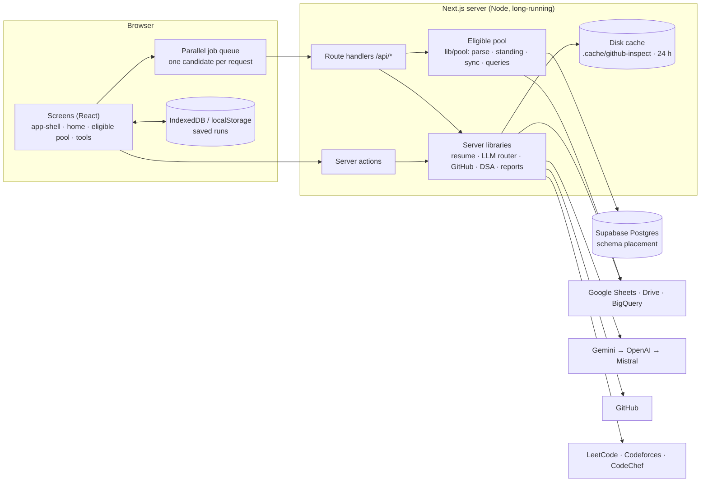
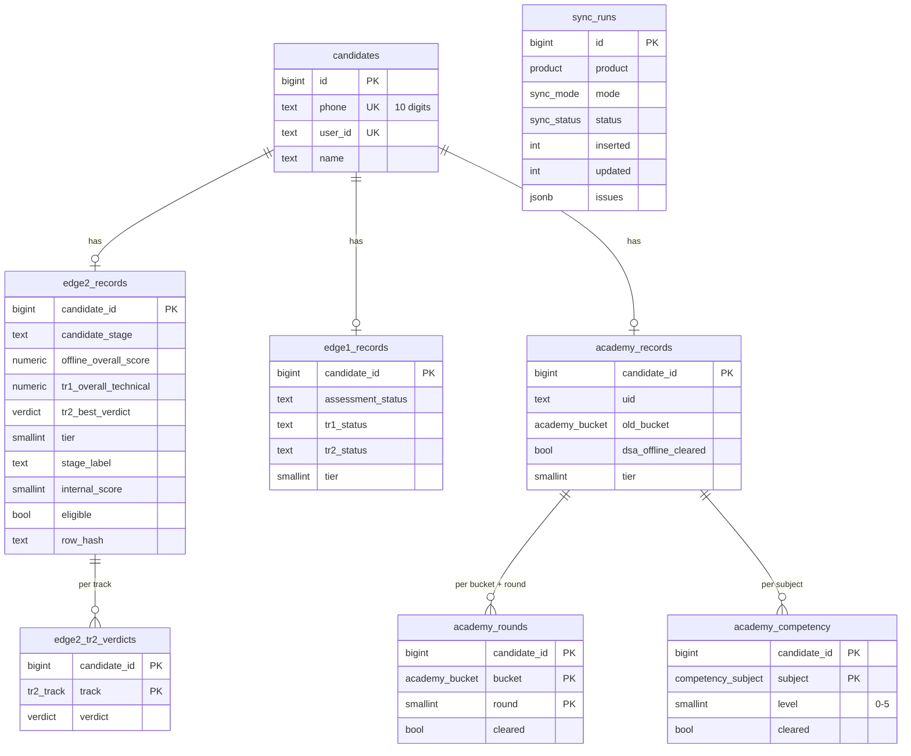
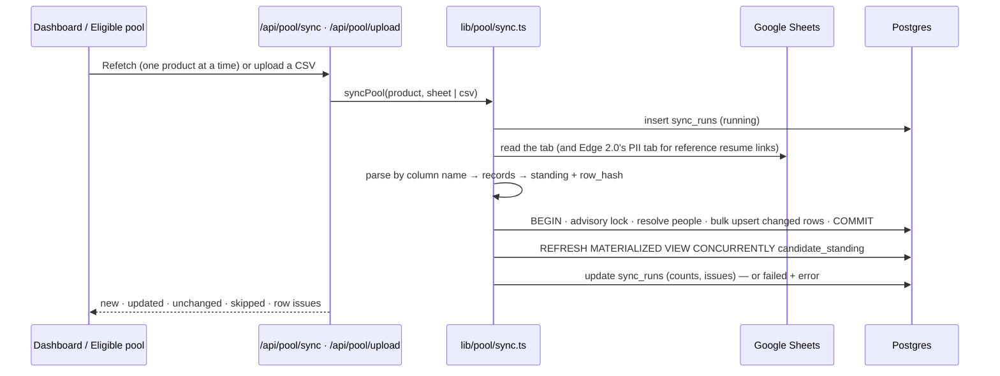

# System architecture, database design and deployment

This document covers how the app is put together, where each kind of data lives, the database
behind the **Eligible pool**, and what a deployment needs. The README covers features and local
setup. Each feature's own rules are in the other files under `docs/`.

## 1. Shape of the system



- **The browser drives long runs.** It sends one candidate per request, a few at a time, and retries
  passing failures. Results are saved in the browser as they arrive. A server restart therefore loses
  only the requests in flight.
- **The server holds no session state.** Each request is self-contained. The only state kept on the
  server is the database (the eligible pool) and a best-effort disk cache.
- **The model reads, the code decides.** Model output is checked before it counts: quotes must be in the
  resume, files must exist in the repo, and mandatory skills must be named in the evidence. Ranking and
  gates are plain code with self-tests.

## 2. Where data lives

| Store | What | Lifetime | Source of truth? |
|---|---|---|---|
| **Postgres (Supabase), schema `placement`** | The eligible pool: internal assessment records for Edge 2.0, Edge 1.0 and Academy, plus the sync log | Permanent | Yes for the app; the Google Sheets stay the upstream source and the pool can be rebuilt from them |
| Browser IndexedDB / localStorage | Saved runs of every tool | Until the user clears site data | Yes, per browser profile |
| Google Drive | PDF reports | Permanent | Yes |
| `.cache/github-inspect/` (disk) | GitHub inspections, project reviews, DSA profiles, trust reviews | 24 h | No; it only saves quota |

Only the data the placement team named is stored in Postgres. Resumes, screening results and model
output are not.

## 3. Database design (Supabase Postgres 17)

### 3.1 Entities



| Table | One row per | Holds |
|---|---|---|
| `candidates` | person | Identity: phone (10 digits, unique), user id (unique), name |
| `edge2_records` | person in the Edge 2.0 pool | Candidate stage, the five assessment scores, the seven TR-1 ratings, the best TR-2 verdict, derived standing, reference resume link |
| `edge2_tr2_verdicts` | person × TR-2 track | Strong / medium / low hire / rejected per track (data analytics, DS/ML, GenAI, Java FS, MERN FS, product, Python FS) |
| `edge1_records` | person in Edge 1.0 | Assessment, TR-1 and TR-2 status, derived standing, reference resume link |
| `academy_records` | person in the Academy pool | UID, YOG, old DSA offline bucket, DSA competency offline result, previous placement, preference, active pool, derived standing |
| `academy_rounds` | person × bucket × round | Bucket A/B/C TR-1 and TR-2 score, status and cleared flag (Bucket C has no TR-2, enforced by a check) |
| `academy_competency` | person × subject | Frontend / DSA / Software / Backend: score, verdict band, clearance, level L1–L5 (0 = below L1) |
| `sync_runs` | sync | Product, sheet or CSV, status, counts (read / new / updated / unchanged / skipped), the first 200 row issues, error, who triggered it |
| `schema_migrations` | applied migration | Version, checksum, time |
| `candidate_standing` (materialized view) | person | Best standing across products, plus every product's standing as JSON |
| `automation.jobs` / `job_requests` / `job_events` / `job_candidates` | sheet-automation run / trigger / event / candidate | Durable jobs with a lease and a step checkpoint, idempotent triggers, the event log, per-candidate checkpoints (migration 003; [`automation.md`](./automation.md)) |

**Derived standing** is computed by the tested rules in `src/lib/pool/standing.ts` when a record is
written. It has four columns: `tier` (1 = TR-2 cleared or top level, 2 = TR-1 cleared, 3 = assessment
cleared, 4 = assessed but not eligible), `stage_label`, `internal_score` (a 0–100 tie-break inside a tier)
and `eligible`. Storing it means every reader agrees on it. `RULES_VERSION` is part of each row's hash,
so changing a rule re-derives every standing on the next sync.

### 3.2 Identity: phone first, then user id

- People are found by **phone number** (normalised to 10 digits) first, then by **user id**. Both columns
  are `UNIQUE`, and every lookup uses one of them.
- The primary key is a **surrogate `bigint` id**, not the phone. Three reasons:
  - 150 Edge 1.0 rows have no phone.
  - A corrected phone number shouldn't cascade through every child table.
  - The other tables reference a small fixed-width key.
- The sync matches a sheet row by phone, then by user id. It fills a missing phone or user id on an
  existing person. If a row's phone and user id belong to two different people, the row is matched by
  phone and the conflict is logged in `sync_runs.issues`.
- Inside one sheet, two rows for the same person are merged, and the stronger standing is kept.

### 3.3 Indexes: only where reads need them

| Index | Serves |
|---|---|
| `candidates(phone)` unique, `candidates(user_id)` unique | Identity resolution during sync (`= any($1)`) |
| `candidate_standing(candidate_id)` unique | Required by `REFRESH … CONCURRENTLY` |
| `candidate_standing(phone)`, `candidate_standing(user_id)`, both partial `where … is not null` | Domain shortlisting's batch lookup. The planner combines them with a BitmapOr |
| `sync_runs(product, started_at desc)` | The latest run per product, and the sync history |
| Primary keys of the record and child tables | Upserts and joins by `candidate_id` |

Nothing else is indexed. The product tables hold thousands of rows and are read whole for the dashboard
aggregates, so more indexes would only slow the writes. Phone columns are `text` with a
`CHECK (phone ~ '^[0-9]{10}$')` (migration 002) so that `phone = any($1::text[])` uses the index without
a cast.

### 3.4 Optimisations

- **Change detection.** Each record carries a SHA-1 `row_hash` of its source fields and the rules
  version. An upsert writes only when the hash changed (`ON CONFLICT … DO UPDATE … WHERE row_hash IS
  DISTINCT FROM excluded.row_hash`). Re-syncing an unchanged sheet writes nothing except a "last seen"
  time.
- **Bulk statements.** Identity resolution, inserts, upserts and child-table rewrites each run as one
  statement over arrays (`unnest($1::text[], …)`). That is a handful of round trips per product, not one
  per row. `xmax = 0` in `RETURNING` separates inserts from updates.
- **One transaction per product sync**, under a transaction-scoped advisory lock, so two syncs never
  interleave. Child rows are replaced only for records that changed.
- **Materialized view** for "best standing per person". It is refreshed `CONCURRENTLY` after each sync,
  so reads never block. Lookups for a whole sheet are one indexed query.
- **Dashboard reads** are about ten small aggregate queries run in parallel.
- **Connection model.** The app uses Supabase's transaction pooler (port 6543) with a small pool (5 per
  server process). Statements are unnamed (no prepared-statement state). `statement_timeout` is 60 s.
  Migrations and admin work use the session pooler (`DIRECT_URL`, port 5432).
- **Missing rows are kept.** A row missing from a later sheet or CSV is not deleted, so a CSV holding only
  new rows is safe. `last_seen_at` shows when each record was last present.

### 3.5 Security

- The tables live in their own schema, `placement`. Supabase's Data API only exposes `public`, so the
  anon / authenticated keys can't reach them. Schema usage is also revoked from `anon`, `authenticated`
  and `public`.
- **Row Level Security** is enabled on every table with no policies (deny by default), in case the
  schema is ever exposed.
- Only the server connects, as the database owner, over TLS. Credentials live in environment variables,
  never in code. The browser reaches the pool only through `/api/pool/*`.
- Phone numbers and names are personal data. Before deploying, the whole app must sit behind sign-in
  (section 7.2).

### 3.6 Migrations

Versioned SQL lives in `db/migrations/NNN_name.sql`. `npm run db:migrate` applies the pending files in
order, each in its own transaction under an advisory lock, and records a checksum.
`npm run db:status` lists applied and pending files. An applied file must never change; the tool
refuses to run if one does. Every change is a new numbered file.

| Migration | Does |
|---|---|
| `001_eligible_pool.sql` | Schema, enums, tables, view, indexes, RLS |
| `002_phone_text_and_rls.sql` | Phone columns `char(10)` → `text` (index-friendly lookups); RLS on `schema_migrations` |

## 4. Keeping the pool current



- **Sources**, overridable with `POOL_<PRODUCT>_SHEET` and `POOL_<PRODUCT>_TAB`:

  | Product | Sheet tab | Notes |
  |---|---|---|
  | Edge 2.0 | "Assessment Cleared- 2027 Pool" | Reference resume links from "All Assessment Cleared PII DATA - 2027" |
  | Edge 1.0 | "Sheet2" | |
  | Academy | "> 8LPA Assessed Pool" | |

- **Columns are found by header name**, so column order and extra columns don't matter. A missing
  required column fails the sync with its name.
- **CSV upload:**
  - The product is detected from the headers. A file that names another product's columns is refused.
  - The same parser and upsert as a refetch are used.
- **Ways to refresh:**
  - "Refetch eligible pool" on the dashboard or the Eligible pool screen.
  - CSV upload on the Eligible pool screen.
  - `npm run pool:sync` (all products, or one with `--csv=file`) for a scheduler.
- **Reference resume links stay reference only.** Domain shortlisting always screens the resume in the
  sheet being shortlisted.

## 5. Standing rules and the shortlist order

| Stage (tier) | Edge 2.0 | Edge 1.0 | Academy (everyone eligible) |
|---|---|---|---|
| 1 · TR-2 cleared / top level | TR-2 Strong or Medium hire (Low hire = not cleared) | TR-2 shortlisted | Bucket A TR-2 cleared, or L3–L5 in any competency interview |
| 2 · TR-1 cleared | TR-1 cleared | TR-1 Strong / Medium hire | TR-1 cleared in Bucket A, B or C (or Bucket B TR-2) |
| 3 · Assessment cleared | DSA offline assessment cleared | Assessment selected | Old DSA offline bucket, or a competency exam |
| 4 · not eligible | — | Assessment not selected | — |

Domain shortlisting looks up every row of the sheet first: by the phone column, then the user id column.
It then:

- Screens assessed people first (TR-2 → TR-1 → assessment).
- Ranks the shortlist in three groups:
  1. **Assessed + good resume**: domain fit 55+, ordered by stage, then score.
  2. **Assessed + average resume**: domain fit 40–54, same order.
  3. **External**: domain fit 55+, ordered by score.
- Applies the gates the run sets (mandatory skills, experience, DSA, commits, presentation) to everyone.
- Treats a person who can't be found, or is tier 4, as external.

If the database can't be reached, the run goes on with everyone treated as external, and the results say
so.

**Domain fit is judged only from projects, experience, certifications and achievements:**

- `lib/resume-sections.ts` takes out the Skills list, the profile summary / objective, coursework,
  interests and languages before the model reads the resume (when the headings can be trusted).
- The same evidence-only text is what core skills, mandatory skills and claimed technologies are checked
  against.
- A fit that rests only on the Skills or Summary sections is capped at 35.

**Deep project review** (`lib/domain-project-review.ts`, `/api/domain/review`):

- Who: the strongest candidates who can still be shortlisted (at most 40, or about twice the top N).
- What: their top one or two domain repositories are downloaded, and a dossier is built (file tree,
  manifests, README, then source in architectural order, 60k characters).
- The model judges relevance, completeness and depth, and lists the features and requirements the code
  proves.
- Every feature must cite files that exist in the repo, or it is dropped.
- The review weighs 60% of the GitHub score in the rank. Reviews are cached for 24 h per repository and
  requirements.

## 6. API surface (server)

| Route | Method | Does |
|---|---|---|
| `/api/pool/summary` | GET | Counts per product and stage, tracks, buckets, levels, sources, recent syncs |
| `/api/pool/sync` | POST `{product}` | Refetch one product from its sheet |
| `/api/pool/upload` | POST multipart `file`, `product` | Upsert a CSV export (`auto` detects the product) |
| `/api/pool/lookup` | POST `{people:[{phone,userId}], include?}` | Standings for up to 20,000 people (phone first, then user id); `include: ["edge2","edge1","academy"]` adds those products' records per candidate id (Standing lookup) |
| `/api/automation/jobs` | POST / GET | Sheet automation: queue a control row's run (Bearer `AUTOMATION_TOKEN`), list recent jobs |
| `/api/automation/jobs/<id>` | GET | One job: status, step, progress, result, `?events=1` for its log |
| `/api/health` | GET | Liveness, the only route open without sign-in; `?db=1` adds a `select 1` shared for 30 s |
| `/api/status` | GET | Readiness behind sign-in: database, pool refetch times, configured integrations (counts / yes-no), `?pdf=1` test render |
| `/api/domain/review` | POST | Deep review of one candidate's top domain repos |

The other routes are listed in the README.

## 7. Deployment

### 7.1 Where to run it

**Today:** a Docker web service on Render (free plan, Singapore), built from `main` with the repository's
`Dockerfile`. The operating guide is [`deployment.md`](./deployment.md).

The app needs a **long-running Node.js server**:

- Puppeteer starts Chromium for PDF reports.
- Single requests can take minutes (assignment review, project review).
- A disk is used for the cache.

Suitable hosts are a container platform (Render, Railway, Fly.io, Google Cloud Run with a long request
timeout and min instances 1, AWS App Runner / ECS) or a VM. Vercel-style serverless functions don't fit
the PDF and long-request work.

```
npm ci
npm run build
npm run db:migrate        # release step; uses DIRECT_URL
npm start                 # PORT from the host
```

The Supabase project should be in or near the host's region (it is `ap-northeast-2` today). Choose a
host region close to it; each pool query is a round trip.

### 7.2 Sign-in is required before exposure

The app has no user accounts of its own. It holds candidate PII and can write to the database, so
**never expose it without sign-in**. Options, strongest first:

1. A sign-in in front of the host: Cloudflare Access, Google IAP, Vercel / Render protection, or an SSO
   proxy limited to the NxtWave Google Workspace.
2. The built-in HTTP Basic sign-in. Set `APP_BASIC_AUTH=user:long-random-password` and every page and
   API route asks for it (`src/middleware.ts`). It only works over HTTPS.

### 7.3 Environment

Everything in `.env.local.example` is set as host environment variables (never commit `.env.local`).
These matter for deployment:

| Variable | Why |
|---|---|
| `DATABASE_URL` | Transaction pooler (6543) for the app |
| `DIRECT_URL` | Session pooler (5432) for migrations |
| `APP_BASIC_AUTH` | Built-in sign-in, if no host-level sign-in is used |
| `AUTOMATION_TOKEN`, `AUTOMATION_WORKER=on`, `AUTOMATION_SPREADSHEET_IDS` | The sheet automation's API secret, its background worker, and the sheets allowed to start jobs |
| `POOL_EDGE2_SHEET` / `_TAB` (and `EDGE1`, `ACADEMY`) | Only if a pool sheet moves |
| `GITHUB_CACHE_DIR` | A persistent volume path if the host's disk is ephemeral (otherwise the cache just starts empty after a deploy) |
| Google service account, model keys, `GITHUB_TOKEN` | As for local runs |

### 7.4 Operations

- **Backups.** Supabase takes daily backups (point-in-time recovery on paid plans). The sheets remain the
  upstream source, so the pool can always be rebuilt with a refetch.
- **Scheduled refresh** (optional). A daily `npm run pool:sync` from the host's scheduler, or the
  dashboard button.
- **Audit.** Every sync is a row in `placement.sync_runs`, with its counts and the first 200 row issues.
- **Rule change.** Edit `lib/pool/standing.ts`, bump `RULES_VERSION`, update `scripts/pool-selftest.ts`,
  then refetch: every record's standing is re-derived.
- **Schema change.** Add `db/migrations/00N_*.sql` and run `npm run db:migrate`. Never edit an applied
  file.
- **Password rotation.** Change it in Supabase, update both URLs in the host's environment, and redeploy.
  Repeated failed logins can briefly lock the pooler, so update the URLs before retrying.
- **Scale.**
  - Today the pool is about 4.7k people and a full refetch takes seconds.
  - At 100k+ people the design still holds: indexed lookups, and the view refresh is linear in rows.
  - Revisit the `max: 5` pool size when running several server instances.
  - Supabase's pooler caps total connections per plan.

### 7.5 Self-tests

```
npx tsx scripts/pool-selftest.ts             # sheets → records, standing rules, CSV detection, matching, priority, gates, review grounding
npx tsx scripts/resume-sections-selftest.ts  # Skills / Summary removal, mandatory check on evidence only
```

## 8. Known limits

- **Rows aren't deleted.** A person dropped from a sheet stays in the pool. `last_seen_at` shows it, and
  deletions are a manual SQL step.
- **Combined-interview clears.** The 46 Edge 2.0 TR-2 clears from a combined interview have no track
  verdict in the agreed columns. They rank as "TR-2 cleared" without a track.
- **Untrusted section layouts.** When a resume's headings can't be trusted (side-by-side columns read row
  by row), only labelled "Skills:" lines are removed. The model's rule still applies.
- **Project review cost.** It needs one model call per reviewed repository, and the free model tiers
  have small daily quotas. That is why it is capped to the strongest candidates and cached.
